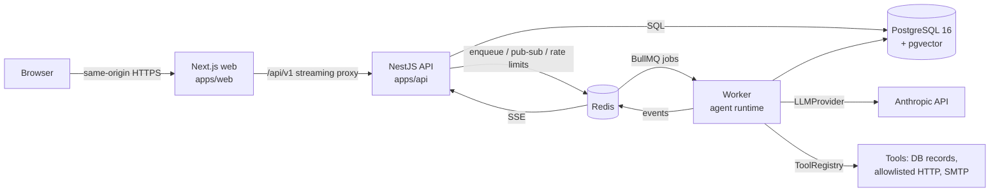
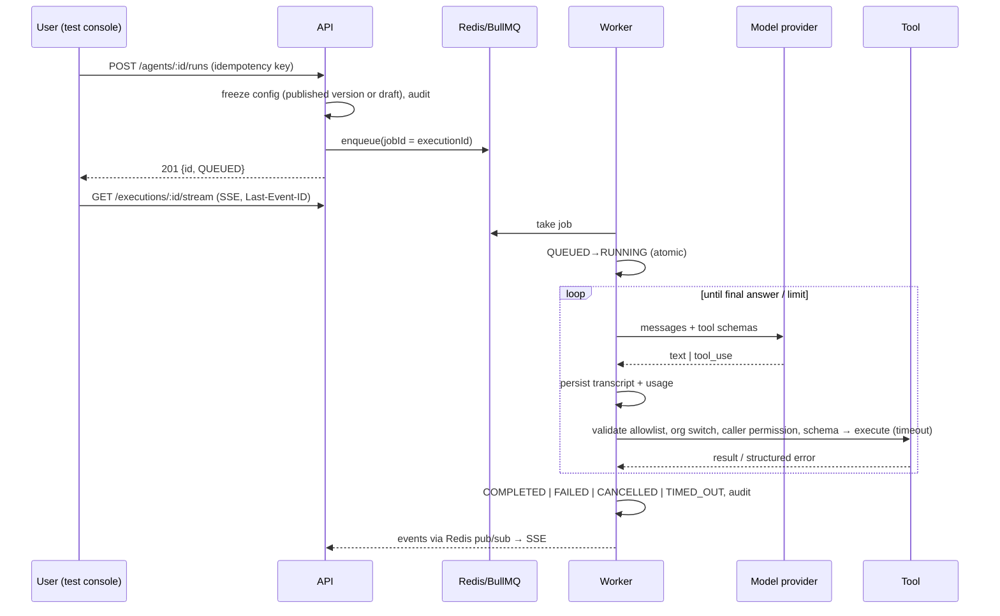

# NexaOS — AI Workforce OS

A multi-tenant platform where organisations build, run and govern AI agents that do real work:
agents reason with a configured model, call permitted tools through a validated backend layer,
and leave a complete, auditable execution history.

> **Status: phase 1 (vertical slice).** Auth, organisations, RBAC, versioned agents, the tool
> registry, the queued agent runtime, real-time execution timelines, audit, usage/cost and the
> dashboard are implemented end-to-end and tested. Knowledge/RAG, workflows, human approvals,
> integrations, API keys and notifications are the next phases (see [Roadmap](#roadmap)); their
> navigation entries are deliberately hidden until they exist.

## Architecture



| Piece | Tech | Responsibility |
|---|---|---|
| `apps/web` | Next.js 16 (App Router), React 19, Tailwind v4, Radix/shadcn-style UI | UI, auth redirects, same-origin streaming API proxy |
| `apps/api` | NestJS 11, Drizzle ORM, BullMQ, pino, prom-client, OpenTelemetry | REST API, auth, RBAC, SSE, audit |
| `apps/api` worker (`dist/worker.js`) | same codebase, separate process | Executes agent runs from the queue; recovery sweeper |
| `packages/shared` | TypeScript + Zod | Permission catalog, execution state machine, request schemas shared by API and web |

Detailed design: [docs/architecture.md](docs/architecture.md). Decisions: [docs/adr](docs/adr).

### Agent run lifecycle



## Repository layout

```
apps/
  api/            NestJS API + worker
    src/
      auth/ orgs/ agents/ executions/ records/ dashboard/ audit/ tools/ llm/ runtime/ health/
      db/schema.ts        Drizzle schema (source of truth)
    drizzle/              SQL migrations (generated + custom triggers)
    test/                 integration tests (real Postgres + Redis)
    scripts/seed.ts       development-only seed
  web/            Next.js app
    src/app/              routes ((auth), (app), onboarding, api proxy)
    src/components/       ui primitives, shell, agents, executions, charts
    e2e/                  Playwright journeys
packages/shared/  permissions, state machine, Zod schemas
docs/             architecture + ADRs
```

## Local development

Requirements: Node 22+, pnpm 10, PostgreSQL 16 (pgvector image recommended), Redis 7.

```bash
pnpm install
docker compose up -d postgres redis          # or use your own Postgres/Redis
cp .env.example apps/api/.env                # set SESSION_SECRET and ANTHROPIC_API_KEY
pnpm --filter @nexa/shared build
pnpm db:migrate                              # applies SQL migrations
pnpm db:seed                                 # optional: demo org (development only)
pnpm dev                                     # API :4000, worker, web :3000 (all with reload)
```

`pnpm dev` builds the shared package, then runs the API, worker and web together. The web app
reads `API_INTERNAL_URL` (default `http://localhost:4000`).

The seed prints a development login (`owner@nexaos.dev`). It refuses to run when `NODE_ENV=production`.
Production screens never depend on seed data.

### Environment variables

Every variable is documented in [`.env.example`](.env.example). Required: `DATABASE_URL`, `REDIS_URL`,
`SESSION_SECRET` (≥ 32 chars), and in production `WEB_ORIGIN`. Agents need `ANTHROPIC_API_KEY`;
without it runs fail visibly with `PROVIDER_NOT_CONFIGURED` (nothing is simulated). The web app
needs `API_INTERNAL_URL`.

### AI provider configuration

Providers implement `LlmProvider` (`apps/api/src/llm/llm.types.ts`) and are registered in
`LlmRegistry`. Anthropic is implemented over raw HTTP with streaming, timeouts, retry with
backoff (honouring `Retry-After`) and error classification (timeout, rate limit, unavailable,
context limit, rejected, malformed). Allowed models: `LLM_DEFAULT_MODEL` + `LLM_ALLOWED_MODELS`.
Cost estimates come from a built-in price table, overridable with `LLM_PRICING_JSON`; models
without a known price report cost as "n/a" rather than a guess.

### Vector database

The Postgres image includes pgvector; the knowledge/RAG phase stores embeddings there
(ADR-0006). No vector tables exist yet.

## Testing

```bash
pnpm test                 # shared + API (unit + integration) + web unit/component tests
pnpm --filter @nexa/api test:unit
pnpm --filter @nexa/api test:integration   # resets the *_test database from migrations
pnpm test:e2e             # Playwright against a running production stack (see below)
```

Integration tests use `apps/api/.env.test` (database `nexa_test`, Redis db 1). The global setup
drops and re-migrates the test schema, so every run proves migrations work from a clean database.
LLM behaviour is exercised with a scripted provider **inside tests only**.

**E2E:** build everything, start API + worker + `pnpm --filter @nexa/web start`, then run
`pnpm test:e2e`. With `E2E_EXPECT_LLM=1` and a real key, the agent journey asserts a real answer
from `getOrder`; otherwise it asserts the run fails visibly with `PROVIDER_NOT_CONFIGURED`.

## Production build & start

```bash
pnpm build
pnpm db:deploy                                   # migrations (idempotent)
node apps/api/dist/main.js                       # API
node apps/api/dist/worker.js                     # worker(s), scale horizontally
pnpm --filter @nexa/web start                    # web (or the standalone server in Docker)
```

### Docker

```bash
cp .env.example .env    # fill in secrets
docker compose --profile app up --build
```

Images: `apps/api/Dockerfile` (API, worker and migrations share one image) and
`apps/web/Dockerfile` (Next standalone). Both run as non-root with health checks.

## API

REST under `/api/v1`, JSON bodies validated with Zod, structured errors
`{ error: { code, message, requestId, details? } }`, opaque keyset cursors for pagination.
OpenAPI UI is served at `/api/docs` (and JSON at `/api/docs/openapi.json`) outside production.
Health: `/health` (liveness), `/health/ready` (DB + Redis). Metrics: `/metrics` (Prometheus, bearer
`METRICS_TOKEN`). Worker: `:4001/health`, `/health/ready`, `/metrics`.

## Security model

- **Sessions:** opaque 256-bit tokens, stored as HMAC hashes; httpOnly, SameSite=Lax cookies
  (`__Host-` prefixed in production); absolute TTL + idle timeout; revoked on logout; all sessions
  revoked on password reset, other sessions on password change.
- **Passwords:** argon2id (OWASP parameters), account lockout after 10 failures, timing-safe login
  for unknown users, no account enumeration on reset.
- **Tenancy:** the active organisation lives on the server-side session and is re-verified against
  memberships on every request; every query is scoped by `organization_id`; foreign ids return 404.
- **RBAC:** roles → explicit permissions (`packages/shared/src/permissions.ts`); routes declare
  `@RequirePermission`. Non-owners can only grant roles below their own; the last owner is protected.
- **CSRF:** SameSite=Lax + Origin/Referer allowlist on state-changing requests.
- **Tool execution (privileged):** per-call checks for agent allowlist, organisation switch, server
  availability, the triggering user's *current* permission and the input schema; timeouts; retries
  only for idempotent tools; mutations deduplicated with `(executionId, callId)` keys; denied calls
  audited. `httpRequest` enforces a host allowlist and blocks private/link-local/metadata addresses
  (checked after DNS resolution and on every redirect).
- **Headers & limits:** Helmet/CSP, CORS allowlist, 1 MB JSON limit, Redis rate limits on auth,
  runs and sensitive routes.
- **Audit:** append-only at the database level (UPDATE/DELETE rejected by trigger); includes actor,
  organisation, action, resource, request/trace id and redacted metadata.
- **Data minimisation:** model transcripts are kept only while a run is in flight; timelines store
  redacted, size-bounded payloads; logs never include cookies, tokens or passwords.

## Deployment

Recommended topology: web and API containers behind a TLS-terminating load balancer, the API not
publicly exposed (web proxies `/api/v1`), N worker replicas, managed Postgres (with pgvector) and
Redis. Set `TRUST_PROXY_HOPS` to the number of proxies in front of the API (web = 1, +1 per load
balancer) so per-IP rate limits see real client addresses. Run `node dist/db/migrate.js` as a
release step. Workers shut down gracefully (in-flight jobs finish; stalled jobs are re-delivered and
resume from persisted state).

**Not verified in this repository:** Docker image builds (no Docker daemon was available in the
build environment) and any cloud deployment. See the implementation report for what was verified.

## Roadmap

1. **Knowledge & RAG** — uploads with MIME/size validation, extraction, chunking, embeddings behind a
   provider interface, pgvector hybrid retrieval with tenant/KB permission filters, citations.
2. **Workflows** — versioned graph editor, validation (cycles, unreachable nodes), durable engine.
3. **Human-in-the-loop** — approval policies, atomic approve/reject, resume-exactly-once.
4. **Integrations, API keys, webhooks, notifications, agent memory.**
