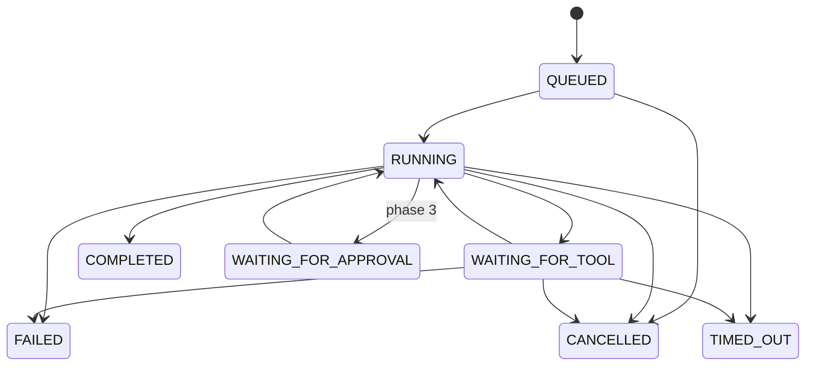

# Architecture

## Domain boundaries (API)

| Module | Owns |
|---|---|
| `auth` | users, sessions, password reset, `AuthGuard` (session → context, permission check) |
| `orgs` | organisations, memberships, role changes |
| `agents` | agents, draft config (optimistic concurrency), immutable versions, readiness validation |
| `llm` | `LlmProvider` interface, provider registry, retry, pricing |
| `tools` | `ToolDefinition` registry, built-in tools, org tool switches, SSRF guard |
| `runtime` | execution state machine, event log, queue, worker, tool executor, cancellation |
| `executions` | run/list/detail/cancel/retry APIs, SSE streams |
| `records` | tenant business data used by tools (customers, orders, tickets) |
| `audit` | append-only audit log |
| `dashboard`, `health`, `metrics` | analytics from real data, readiness, Prometheus |

## Request context and tenancy

`AuthGuard` resolves the session cookie → `AuthContext`, then joins the session's active
organisation with `memberships` → `OrgContext { orgId, role, permissions }`. Services receive the
context and filter every query by `ctx.orgId`. Clients never supply the tenant.

## Execution state machine

Transitions are single `UPDATE … WHERE status IN (legal sources)` statements, so concurrent actors
(worker vs. cancel API vs. sweeper) cannot both win. Each transition appends a timeline event in
the same transaction.

## Reliability

- **Idempotent enqueue:** BullMQ `jobId = executionId`.
- **Resume, not restart:** the transcript and step count are persisted after every model step. If
  the last message is an assistant tool request, a resumed worker executes those calls instead of
  asking the model again, so tool call ids stay stable.
- **Side-effect safety:** tool calls are unique on `(execution_id, call_id)`. Completed calls are never
  re-run; mutation handlers dedupe on the idempotency key; an interrupted non-idempotent call is
  reported as `TOOL_OUTCOME_UNKNOWN` rather than repeated.
- **Recovery sweeper** (leader-elected via Redis `SET NX`): re-enqueues orphaned `QUEUED` runs and
  times out runs whose deadline passed with no live worker.
- **Limits:** max steps, wall-clock deadline (AbortSignal through model and tool calls), token budget.

## Real-time

Events are persisted with a per-execution `seq`, then published on `nexa:org:{orgId}`. The SSE
endpoint subscribes first, replays `seq > Last-Event-ID` from Postgres, then flushes buffered live
messages with dedupe, so reconnects never drop or duplicate. Model text deltas are streamed but not
persisted. The org-wide stream drives list/dashboard refreshes.

## Observability

pino JSON logs with request ids (propagated from `x-request-id`) and redaction; execution
`trace_id` recorded on runs and agent audit events; Prometheus metrics for HTTP, model latency,
tokens, cost, tool latency, run outcomes/duration and queue depth; optional OpenTelemetry
auto-instrumentation via `OTEL_EXPORTER_OTLP_ENDPOINT`.
